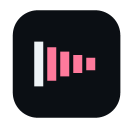

# my-chromium-extensions

A small collection of local-first Chromium extensions, built for personal use and loaded unpacked.

| Icon | Extension | What it does | Version | Load path |
| --- | --- | --- | --- | --- |
|  | Audio Normalizer | Keeps every site at one comfortable loudness in the browser. | 5.4.2 | `packages/audio-normalizer` |
|  | Slowed Reverb | Slows a YouTube track and washes it in plate reverb, right in the browser. | 1.0.2 | `packages/slowed-reverb` |
|  | Crunchy Presence | Shows the Crunchyroll episode you are watching as Discord rich presence (local only). | 1.0.0 | `packages/crunchy-presence` |

## Install

There are no store listings. Load each extension unpacked from source:

1. Clone this repo.
2. Open `chrome://extensions`.
3. Turn on **Developer mode**.
4. Click **Load unpacked** and pick `packages/<name>` — the folder holding that package's `manifest.json`.

Each package folder is directly loadable; there is no build step.

## Crunchy Presence

It needs a local native-messaging host for Discord IPC. From the repo root:

```
node packages/crunchy-presence/scripts/install-host.mjs
```

Check without writing:

```
node packages/crunchy-presence/scripts/install-host.mjs --check
```

It talks to Discord Canary over `\\.\pipe\discord-ipc-0` (scanning `-0` through `-9`).

## Development

Per-package tests, exactly as each package defines them:

```
node --test packages/crunchy-presence/test/
cd packages/audio-normalizer && node --test tests/
cd packages/slowed-reverb && node test/mute-enforce.test.js
```

## Layout

```
packages/
  audio-normalizer/   per-site loudness levelling (MV3, local audio graph)
  crunchy-presence/   Crunchyroll watch state to Discord via a Node native host
  slowed-reverb/      YouTube slowdown plus plate reverb (MV3, local audio graph)
```

## Scope

Local-first: unpacked loading only, no store publishing, no npm release, no telemetry.
